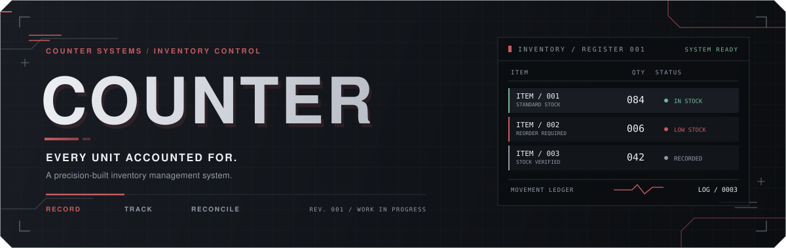

 

  <strong>A precision-built inventory management system.</strong>
    
  
  
  

 

<a href="#overview">OVERVIEW</a>　/　
<a href="#features">FEATURES</a>　/　
<a href="#design">DESIGN</a>　/　
<a href="#architecture">ARCHITECTURE</a>　/　
<a href="#roadmap">ROADMAP</a>

---

### 01 / KNOW WHAT YOU HAVE.
### 02 / KNOW WHAT CHANGED.

*Every unit accounted for. Every movement recorded.*

## 01 &nbsp; OVERVIEW

**Counter is an inventory management system built around one principle: stock should be accounted for, not merely counted.**

Products enter, products leave, and quantities change. Counter provides a structured way to manage these operations, monitor stock, and trace the movements behind every balance.

Instead of treating inventory as editable numbers, Counter treats stock as a record of transactions.

<table>
<tr>
<td width="50%" valign="top">

<h3>▤ THE INVENTORY</h3>

- Product and SKU records
- Categories and suppliers
- Quantities and reorder thresholds
- Search, sorting, and filtering
- Stock valuation

</td>
<td width="50%" valign="top">

<h3>↔ THE LEDGER</h3>

- Stock receipts and issues
- Quantity adjustments
- Timestamped movement history
- Product-level audit trails
- Traceable corrections

</td>
</tr>
</table>

> [!NOTE]
> Counter is a work in progress. The features and technologies below describe the intended direction, not necessarily completed functionality.

## 02 &nbsp; FEATURES

<table>
<tr>
<td width="42" align="center" valign="top">▤</td>
<td>

**01 — Product Registry**

Manage products, unique SKUs, categories, suppliers, costs, quantities, and reorder thresholds in one searchable catalogue.

</td>
</tr>
<tr>
<td align="center" valign="top">↔</td>
<td>

**02 — Stock Operations**

Record receipts, issues, and adjustments with quantities, timestamps, reasons, and optional references.

</td>
</tr>
<tr>
<td align="center" valign="top">≡</td>
<td>

**03 — Movement Ledger**

Inspect chronological stock changes and trace the history behind a product's current balance. Correct posted movements through additional records rather than silently rewriting history.

</td>
</tr>
<tr>
<td align="center" valign="top">!</td>
<td>

**04 — Stock Awareness**

Identify low-stock and out-of-stock products through clear, actionable indicators.

</td>
</tr>
<tr>
<td align="center" valign="top">⌕</td>
<td>

**05 — Search & Retrieval**

Find products quickly, combine filters, sort records, and move directly from a catalogue entry to its details and history.

</td>
</tr>
<tr>
<td align="center" valign="top">▦</td>
<td>

**06 — Overview & Reporting**

Surface useful metrics such as product counts, stock value, low-stock items, and recent movements, with future support for exports and movement summaries.

</td>
</tr>
</table>

## 03 &nbsp; DESIGN IDENTITY

**INDUSTRIAL RESTRAINT × ENGINEERED PRECISION**

Counter draws on Stripe's compositional discipline and Render's crisp geometry, paired with the interaction polish of premium software.

The interface is dark, structured, and deliberately restrained. Strong typography, aligned grids, fine borders, and carefully layered surfaces do the work — not excessive cards, gradients, or glow.

### The palette

<table>
<tr>
<td align="center" width="25%">

 <strong>CARBON</strong>
 <code>#0B0D10</code>
</td>
<td align="center" width="25%">

 <strong>GRAPHITE</strong>
 <code>#12151A</code>
</td>
<td align="center" width="25%">

 <strong>STRUCTURE</strong>
 <code>#292E36</code>
</td>
<td align="center" width="25%">

 <strong>PRECISION WHITE</strong>
 <code>#ECEEF2</code>
</td>
</tr>
<tr>
<td align="center">

 <strong>VELVET RED</strong>
 <code>#C45B61</code>
</td>
<td align="center">

 <strong>TITANIUM</strong>
 <code>#9299A5</code>
</td>
<td align="center">

 <strong>OPERATIONAL GREEN</strong>
 <code>#76B69A</code>
</td>
<td align="center">

 <strong>RAISED GRAPHITE</strong>
 <code>#191D23</code>
</td>
</tr>
</table>

### Design principles

- **RED** marks primary actions and important emphasis.
- **GREEN** communicates successful operations.
- **TONAL SURFACES** establish hierarchy without visual clutter.
- **PRECISE MOTION** confirms actions and clarifies state changes.
- **FEEDBACK FIRST** — loading, validation, empty, success, and error states are part of the design.

The goal is to make every interaction feel deliberate without making animation the point of the interface.

## 04 &nbsp; SYSTEM PRINCIPLES

### THE NUMBER IS THE RESULT. THE MOVEMENTS ARE THE RECORD.

<table>
<tr>
<td width="50%" valign="top">

**01 / TRACEABILITY**

Every stock change has a recorded reason and history.

</td>
<td width="50%" valign="top">

**02 / CONSISTENCY**

Database transactions keep related operations together.

</td>
</tr>
<tr>
<td width="50%" valign="top">

**03 / INTEGRITY**

Validation and constraints help prevent invalid inventory states.

</td>
<td width="50%" valign="top">

**04 / CLARITY**

Important quantities, warnings, and actions remain easy to find.

</td>
</tr>
</table>

### Inventory in practice

| Movement | Change | Balance |
|:--|--:|--:|
| Opening stock | +50 | 50 |
| Supplier receipt | +20 | 70 |
| Stock issued | −8 | 62 |
| Physical-count adjustment | −2 | 60 |

The resulting balance is **60 units**. The movement ledger explains how it got there.

## 05 &nbsp; ARCHITECTURE

Counter is planned as a full-stack application with distinct presentation, application, and data layers.

<table>
<tr>
<td align="center" width="33%">

<strong>01 / PRESENTATION</strong>

 

Interface · Forms · Tables

</td>
<td align="center" width="33%">

<strong>02 / APPLICATION</strong>

 

Validation · Stock logic

</td>
<td align="center" width="33%">

<strong>03 / PERSISTENCE</strong>

 

Database · Transactions

</td>
</tr>
</table>

### Core data model

- **Products** — names, SKUs, costs, categories, suppliers, and reorder levels.
- **Categories** — product grouping.
- **Suppliers** — contact details and product relationships.
- **Stock movements** — type, quantity, timestamp, reason, and reference.
- **Users / workspaces** — potential future support for authenticated, multi-user access.

Stock balances should be derived from movements or maintained transactionally alongside them, never allowed to drift independently.

### Planned technology direction

| Layer | Technology |
|:--|:--|
| Frontend | React + TypeScript |
| Styling | SCSS modules or Tailwind CSS |
| Backend | FastAPI or NestJS |
| Database | PostgreSQL |
| Quality | Validation, database constraints, automated tests |

*These are planned choices and may change during development.*

## 06 &nbsp; ROADMAP

01 FOUNDATION　→　
02 OPERATIONS　→　
03 VISIBILITY　→　
04 REFINEMENT

- [ ] **Foundation** — Project structure, data model, validation, and design system.
- [ ] **Product Registry** — Product, category, and supplier management.
- [ ] **Stock Operations** — Receipts, issues, adjustments, and movement ledger.
- [ ] **Inventory Overview** — Live metrics and stock alerts.
- [ ] **Reporting** — Valuation, movement summaries, and CSV import/export.
- [ ] **Quality & Deployment** — Tests, responsive layouts, accessibility, and deployment.
- [ ] **Refinement** — Interaction polish and workflow improvements.

The priority is to establish reliable inventory operations before expanding the feature set.

## 07 &nbsp; PHILOSOPHY

### PRECISION IS NOT AESTHETIC. IT IS BEHAVIOUR.

Counter is a personal project exploring practical full-stack engineering and deliberate interface design.

Its scope is intentionally grounded: products need to be recorded, quantities need to be accurate, and changes need to be understandable.

The ambition is not to make inventory management something it isn't. It is to build an ordinary, useful application with enough care that its data model, engineering, interface, and interactions feel like parts of the same system.

**A straightforward tool, engineered with intent.**

---

  

▤ **COUNTER** / **SYSTEM STATUS: IN DEVELOPMENT**

INVENTORY MANAGEMENT · PRECISION ENGINEERING · WORK IN PROGRESS

